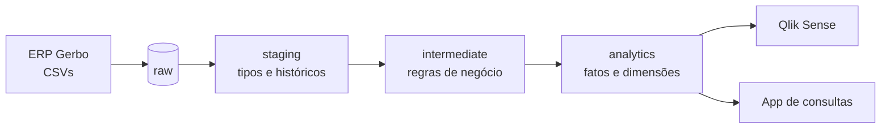

[README.md](https://github.com/user-attachments/files/35106038/README.md)
# profile<!-- Banner com o degradê da CAS (#1A7CFF → #18C6F0 → #1FE07A) -->

  

  

  
  
  
  
  

---

##  Olá, somos o time de dados da CAS

Transformamos os dados do ERP **Gerbo** em informação confiável para toda a empresa: um **data warehouse** único, com regras de negócio documentadas, testadas e rastreáveis até a origem, que alimenta os painéis do **Qlik Sense** e o nosso **app de consultas**.

---

##  O que fazemos

<table>
  <tr>
    <td align="center" width="25%">
       
      <b>Data Warehouse</b> 
      Gerbo → PostgreSQL → dbt, em camadas staging, intermediate e analytics
    </td>
    <td align="center" width="25%">
       
      <b>Painéis gerenciais</b> 
      Faturamento, backlog, contas a receber, despesas e projetos no Qlik Sense
    </td>
    <td align="center" width="25%">
       
      <b>App de consultas</b> 
      Páginas em Streamlit para consultar, filtrar e exportar para Excel
    </td>
    <td align="center" width="25%">
       
      <b>Qualidade</b> 
      Testes automáticos e conciliação ao centavo com o painel atual
    </td>
  </tr>
</table>

---

##  Em andamento

| | Projeto | Situação |
|:---:|---|---|
|  | **Migração do QlikView Gerencial para o dbt** | faturamento, devolução, backlog e serviços em produção; contas a receber e despesas validados |
|  | **Horas e mão de obra** | próxima fase, começando pelas horas estimadas |
|  | **Integrações externas** | Gauss na Gerência de Projetos; MS Project e documentos a seguir |
|  | **Planejamento** | orçamento, forecast e DRE |

---

##  Como os dados fluem

---

##  Ferramentas

  

---

##  Time

<table>
  <tr>
    <td align="center"><a href="https://github.com/cdw-adriano"> <b>Adriano</b></a> Responsável pelo DW</td>
    <td align="center"><a href="https://github.com/marciogalvao-cas"> <b>Marcio</b></a> Engenharia de dados</td>
    <td align="center"><a href="https://github.com/willianadolpho-ai"> <b>Willian</b></a> Engenharia de dados</td>
  </tr>
</table>

---

##  Nossos princípios

-  **Rastreável:** toda coluna diz de onde vem no Gerbo.
-  **Reaproveitável:** uma regra, um lugar; as áreas compartilham modelos em vez de copiar.
-  **Documentado:** cada modelo tem descrição, testes e o porquê das regras.
-  **Um número só:** o mesmo valor no painel, no app e na planilha.

  

